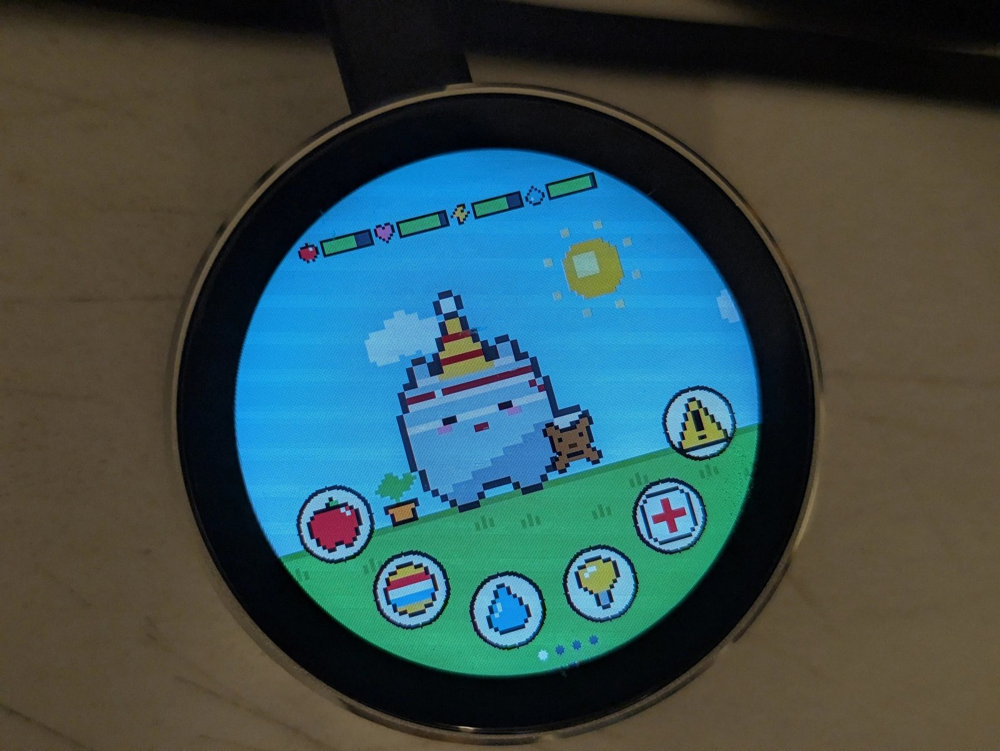
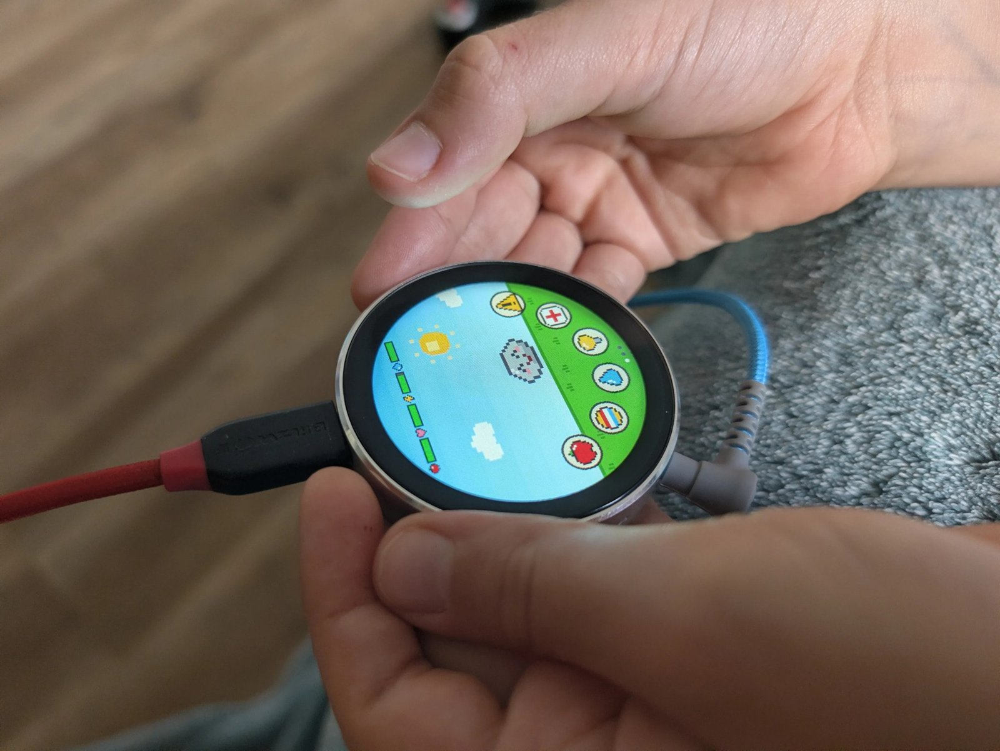
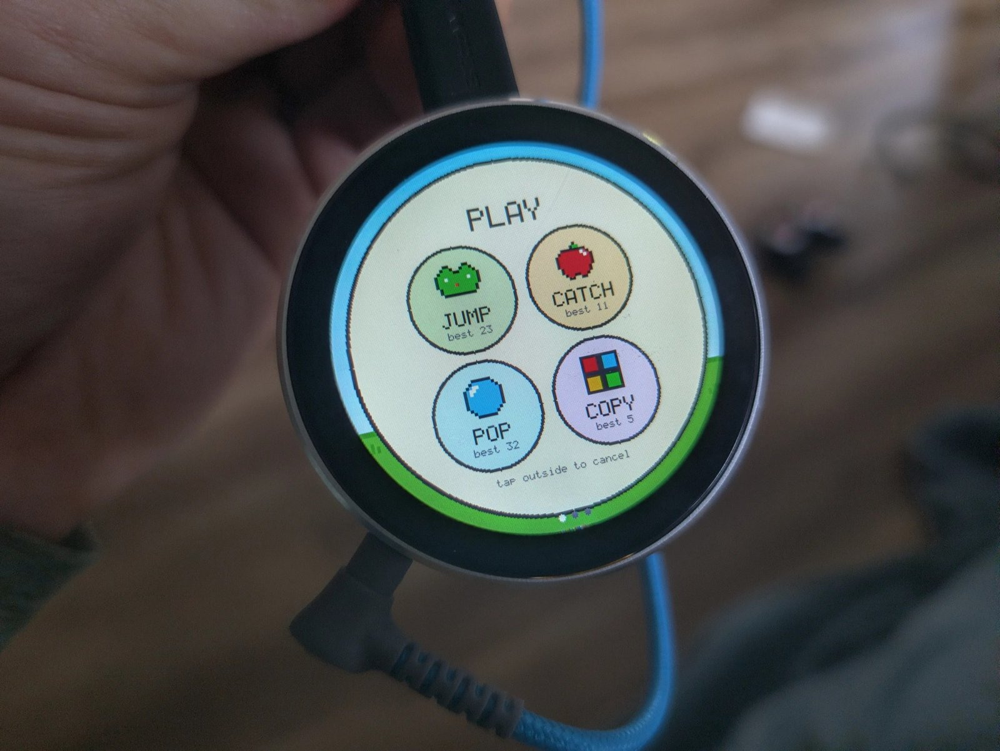
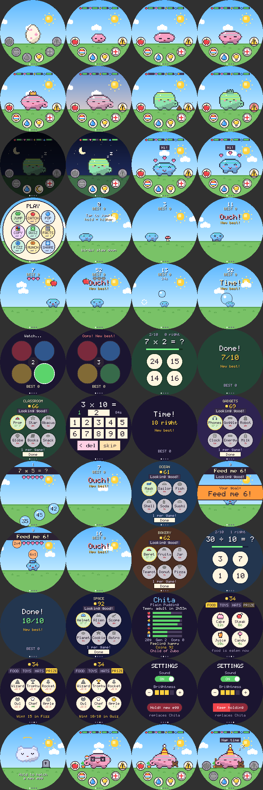
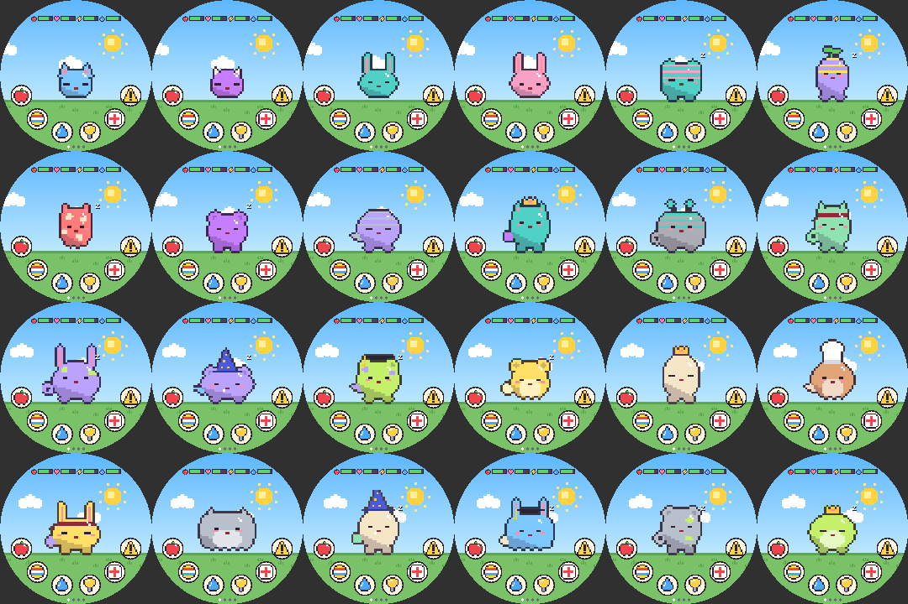
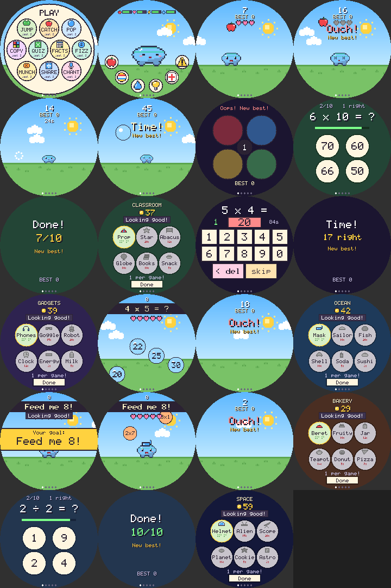
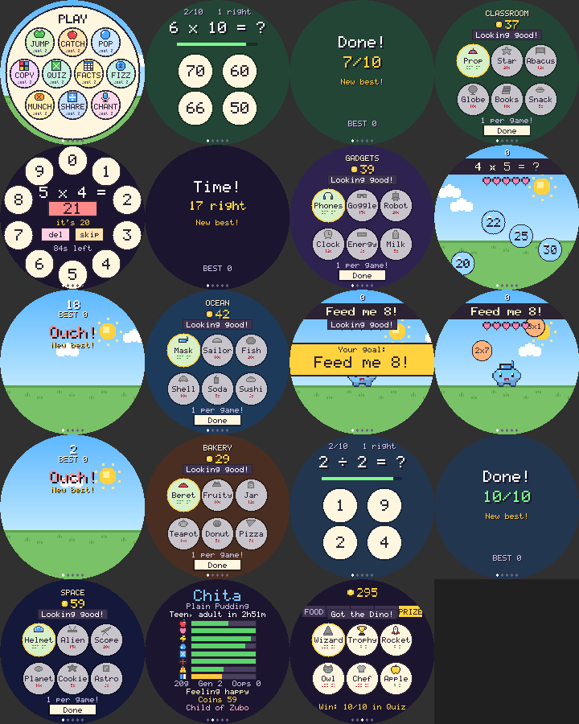
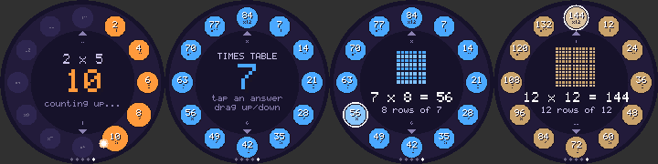
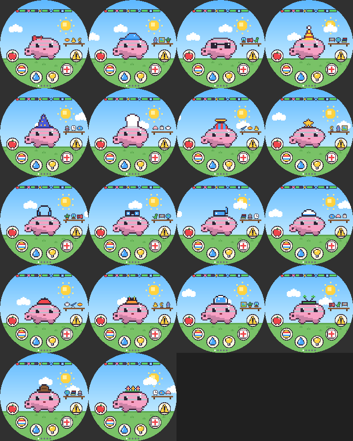
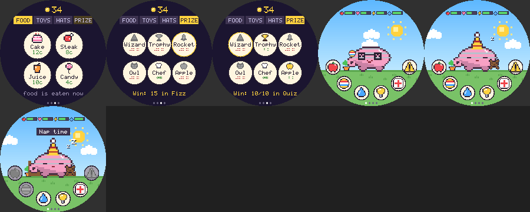

# Orbling

A virtual pet for the round **Guition JC3636W518** touch display (ESP32-S3, 1.8" 360x360 ST77916 QSPI, CST816
touch), built as an [ESPHome](https://esphome.io) external component. Every egg rolls a random pet: body shape,
colour, ears or horns, eyes, pattern, tail, feet and name. The features show up as it grows: a baby is a plain
blob, ears come with the child stage, pattern and feet with the teen stage, tail and its adult form (decided by how
it was raised) as an adult. Old pets leave an egg that takes after them, so a family line builds up.

Nine mini games, five of them times-tables and division practice, earn coins for a shop and a prize stand. In
Home Assistant the pet shows up with its stats, care buttons and a "needs attention" sensor to notify on.

<p>
  
  
  
</p>




## Install

You need a Guition JC3636W518 round display (tested on the JC3636W518C) and a USB-C data cable. For sound, plug
headphones or a powered speaker into its 3.5 mm jack.

### Web installer (no setup)

1. Open **https://clowrey.github.io/orbling/** in Chrome or Edge on a computer.
2. Plug in the board, click **Connect**, pick its serial port and install.
3. When it asks, choose your Wi-Fi network. (Missed it? The pet opens an `orbling-xxxxxx` Wi-Fi access point;
   join it and pick your network there.)

Home Assistant finds it on its own (Settings → Devices & services). New releases show up as a **Firmware**
update in Home Assistant.

### ESPHome Device Builder

After installing with the web installer, the board appears in the ESPHome Device Builder with **Adopt**. That
makes a small config of your own that pulls in [`orbling.yaml`](orbling.yaml) as a package, so you can change
the substitutions and add things. To start from scratch instead:

```yaml
substitutions:
  name: orbling
  friendly_name: Orbling
  timezone: America/Los_Angeles  # only used without Home Assistant

packages:
  orbling: github://clowrey/orbling/orbling.yaml@main

esphome:
  name: ${name}
  name_add_mac_suffix: false

api:
  encryption:
    key: !secret orbling_api_key

wifi:
  ssid: !secret wifi_ssid
  password: !secret wifi_password
```

### Clock and time zone

The pet sleeps at night (21:00–07:00) and makes up for time it was switched off, so it needs the time. With Home
Assistant it takes the time and time zone from there. Without Home Assistant it uses internet time in the
`timezone` substitution, which is UTC in the web installer firmware; build your own config (above) to set yours.

## Playing

| Where | What |
|---|---|
| Buttons, left to right | Feed (meal or snack), Play (game menu), Clean, Light (off = nap, on = wake), Medicine, Scold |
| Tap the pet | Pat it (happiness) |
| Tap the gauges at the top | Stats page |
| Swipe left / right | Pet → stats → shop → settings → times tables pages (the times tables are also one swipe right from the pet); tap the stats page to go back |
| Shop page | Coins at the top; tabs for food, toys and hats; tap an item twice to buy it, tap an owned hat to wear it |
| Settings page | Sound on/off, brightness (4 levels), **New egg** (hold 2 s; replaces the pet) |
| Hold anywhere after it is gone | Hatch a new egg |

The four gauges are food (apple), happiness (heart), energy (bolt) and cleanliness (drop). Health and
discipline are on the stats page, with weight, generation, care mistakes, coins, its parent, and how much more
time together until it grows up.

**It runs fast while you are with it and dozes when you are not.** A touch in the last 5 minutes counts as
"with you": its needs then run 15x faster than real time, so in a 15–20 minute session it gets hungry, poops, gets
tired and wants to play. Untouched for 5 minutes it dozes (eyes shut, a small "z", the screen dims): needs then run
30x slower than with you, and it cannot get sick, throw a tantrum or count a care mistake. The first touch wakes it,
and it says what it needs most ("I'm hungry!", "Clean up?", "Play with me!").

**Energy** only refills while it sleeps: at night, or a nap when you turn the light off (it says "Sleepy...
lights off?" when the bolt gets low). In the dark the bolt fills from empty in 1 minute (2 with the light on); a
daytime nap ends by itself when it is full, or when you turn the light back on.

**Play** opens a menu of nine games; the last five are math games (times tables and division). The score sets how much happier it gets (up to +35); every game costs
energy, Jump and Catch burn a little weight, and each game keeps its best score.




- **Jump**: the pet runs; tap to jump over rocks, mushrooms and bushes, and hold for a higher jump to grab stars
  (+3). From score 8 birds swoop in low: stay on the ground and run under them. It speeds up with every
  obstacle, and from 12 they sometimes come in quick pairs.
- **Catch**: drag the pet left and right under falling apples (+1) and cakes (+2). Catching a rock or dropping
  fruit costs one of three lives; things fall faster as you go.
- **Pop**: 30 seconds to tap bubbles before they float away. Red spiky ones cost 3 points; bubbles get quicker.
- **Copy**: four coloured pads light up (each with its own note); tap them back in the same order. One more step
  each round.
- **Quiz** (times tables): "7 x 8 = ?" with four answers to tap, 10 questions, 20 seconds each. A right answer
  turns green; a wrong one turns red and the right one lights up, with the whole fact underneath. The wrong
  answers are the tempting ones (a neighbouring row or column, or one off). Questions start with the easy tables
  (x2, x5, x10), then add x3 and x4, then everything up to 10 x 10.
- **Facts** (times tables): "6 x 4 =" and a big number keypad (two rows of five digits, then wide delete and skip keys); type the answer, as many as you can in 90 seconds. It
  checks as soon as enough digits are typed; a wrong answer shows the right one. `< del` deletes a digit, `skip` skips
  (and shows the answer). It moves on to harder tables as the score goes up (x3 and x4 after 5 right, everything after 12).

- **Fizz** (times tables): "6 x 7 = ?" and four number bubbles float up; pop the right one before it gets away.
  A wrong pop, or letting the answer escape off the top, costs one of five lives. Bubbles take about 11 seconds
  to float up and only speed up a little with each right answer; from 15 points some questions are missing a
  factor: "? x 6 = 42".
- **Munch** (times tables): "Feed me 24!" Food falls with facts on it (4x6, 3x8, 5x5...); drag the pet under the
  ones that make the target and away from the rest. A wrong one it eats (it has to be right above its mouth) gives it a tummy ache (one of five lives);
  missing a right one costs nothing. Food falls slowly, about 2 seconds apart, and only
  a little faster as you go. Every four right ones the target changes: a flashing "New goal! Feed me 36!" banner slides across the middle
  with a chime, and the food waits for those two seconds; bigger targets come after 8 and 16.

- **Share** (division): "18 ÷ 3 = ?" with four answers to tap, 10 questions, 20 seconds each (like Quiz, on a blue
  board). It starts with ÷2, ÷5 and ÷10. After each answer it shows the times-table fact behind it ("since 3 x 6 =
  18"), so division links back to multiplication.

**Times tables** (a homework helper, one swipe right from the pet) lays a table out like a clock: x1 at one
o'clock round to x12 at twelve, so the whole table is on the screen at once. It opens by counting up: a light sweeps
round the ring and each answer pops in while the middle counts 7, 14, 21... Drag up or down to run through the
tables, 1 to 12: they change straight away as your finger moves, one table for every 22 px or so, so one long drag
goes through several (up for bigger tables). The small arrows step one at a time. Tap an answer to see that fact in the middle with a picture of it:
7 x 8 shows 8 rows of 7 dots, with a gap every five to make counting easy. Changing table keeps the picked fact
(7 x 8 becomes 8 x 8). Tap the middle to go back to the table, and again to count it up again. It is not a game:
no coins or Smarts.



The math games are worth more: 1 coin per right answer, and less tiring than the others. Every right answer
also raises **Smarts**.

**Smarts** (intelligence, the book on the stats page) only goes up, with right answers in the times-tables games: fast
at first (1.2 a right answer) and slower near the top, so about 90 right answers reach 60 and about 180 reach 100. A
pet with Smarts 50 or more when it grows up becomes a **Brainy** adult with a graduation cap. An egg left by an elder
starts with a quarter of its parent's Smarts.

**The prize stand** opens at the end of every math game, however it went, so the coins just earned can be spent
straight away. Each math game has its own page of six things the shop never sells, and **you can buy one item per
game played** (after that the rest go grey: "1 per game!"). Tap once to pick, again to buy; tap an owned hat to put
it on or take it off; **Done** to leave (it also closes after 30 seconds untouched).

| Game | Page | Hats | Room (study shelf) | Treats (eaten at once, can be bought again) |
|---|---|---|---|---|
| Quiz | Classroom | Propeller cap 15, Gold star 20 | Abacus 12, Globe 18, Books 10 | Brain snack 5: Smarts +2, happiness +10 |
| Facts | Gadgets | Headphones 15, Goggles 15 | Robot 20, Clock 12 | Energy bar 6: energy +30; Milk 5: health +10, food +10 |
| Fizz | Ocean | Snorkel mask 15, Sailor hat 18 | Fishbowl 20, Seashell 10 | Soda 5: happiness +15; Sushi 6: food +30 |
| Munch | Bakery | Beret 15, Fruit hat 18 | Cookie jar 12, Teapot 14 | Donut 5: happiness +20; Pizza 7: food +40, happiness +10 |
| Share | Space | Space helmet 20, Alien antennae 15 | Telescope 20, Planet 16 | Star cookie 5: Smarts +1; Astronaut ice cream 6: happiness +20, energy +10 |

Room things sit on the study shelf on the right of its room, three at a time, taking turns every 6 seconds.
**Hold the pet** (about a second) to try on the next hat it owns; after the last one it takes its hat off.


**Math prizes** can't be bought: they are only won in the times-tables games, and kept by the household. They are on
the shop's PRIZE tab (locked ones are grey; tap one to see how to win it):

| Prize | How to win it | What it is |
|---|---|---|
| Wizard hat | 10/10 in Quiz | a starry wizard hat, worn at once (tap it in the shop to take it off) |
| Trophy | 20 right in one round of Facts | a gold cup on the shelf in its room |
| Rocket | 15 in one round of Fizz | a rocket on the shelf |
| Owl | Smarts 60 | an owl on the shelf |
| Chef hat | 15 right in one round of Munch | a puffy white chef's hat, worn at once |
| Golden apple | 25 right in one round of Munch | a golden apple on the shelf |

**Discipline.** Now and then the pet throws a tantrum for no reason: it stomps about with an angry face, a red
"!" bubble, and the Scold button flashes. It refuses food and play ("Won't! (scold it)"). Scold it within 2
minutes for +25 discipline; ignore it and discipline drops 5. Scolding when it did nothing wrong costs 10
happiness. The better behaved, the rarer the tantrums (none at 100); below 40 discipline it sometimes says no
to food or play anyway.

## Rules

The rules run in "pet minutes": 15 per real minute with you, 0.5 per real minute while it dozes. Night (21:00–07:00
local time) is real time: it sleeps then whatever you do.

- **Growing up** follows *time together*: time with you counts fully, dozing time 1/20. The egg hatches after a
  minute with you; **child** at 20 minutes together, **teen** at 1 hour, **adult** at 3 hours (form decided),
  **elder** at 8 hours, and at 12 hours the elder sets off on an adventure and leaves an egg. Playing 30 minutes a
  day that is an adult on day 2 and a new generation in about a week; the stats page counts down to the next stage.
- With you: food lasts about 40 minutes (a baby's 27), happiness about 45, energy about 53. It naps when the bolt
  is empty or the light goes off. Dozing: food lasts about 20 hours.
- Meals bring poop 5–10 minutes later (with you). Poop, dirt, starving and overeating can make it sick (only while
  you are there); medicine cures it. More than three snacks in a quarter of an hour gives it a tummy ache.
- Health only drops from neglect: sick, starving, miserable (happiness 0) or filthy, and four times slower while it
  dozes. Away for 3 days it is in poor shape but recovers; abandoned for good it lasts about 8 days. Health 0 and
  it is gone (hold the screen for a new, unrelated egg).
- A **care mistake** is a need (hungry, sad, dirty, sick, lights left on while asleep, a tantrum) ignored for 8
  minutes while someone is there.
- When it was off (a power cut), the missed time is made up as dozing, at most 3 days. The state is saved to flash
  every 30 s when something changed; saves from older firmware are upgraded.

## Shop



Coins come from games (about half the score in Jump and Catch, a third in Pop, double in Copy, one per right
answer in Quiz and Facts) and 10 for each
stage it grows up; a new household starts with 20. Coins, toys and hats belong to the household and pass down
to the next pet.

| Tab | Item | Price | What it does |
|---|---|---|---|
| Food | Cake | 12 | happiness +30, food +10, weight +2 |
| | Steak | 8 | food +50, weight +1 |
| | Juice | 10 | energy +40, happiness +5 |
| | Candy | 4 | happiness +10 |
| Toys | Ball | 25 | it bounces it now and then; happiness drops slower |
| | Teddy | 30 | it cuddles it while it sleeps or dozes; no sadness then |
| | Plant | 20 | sits by it; cleanliness drops half as fast |
| | Bed | 40 | it sleeps in it; naps twice as fast |
| Hats | Bow, Cap, Specs, Party hat | 15–25 | worn on the pet; tap again to take off (a hat hides a crown) |

Food is eaten on the spot (it switches to the pet page to watch).

**Adult forms**, decided when it becomes an adult (first match wins):

| Form | When | Looks |
|---|---|---|
| Scruffy | 5 or more care mistakes | greyer, messy tuft |
| Royal | at most 1 care mistake and discipline 70+ | gold crown |
| Brainy | Smarts 50+ | graduation cap with a gold tassel |
| Wild | discipline under 30 | spiky crest, a fang |
| Chubby | weight over 45 g | wider body |
| Sporty | 5+ games played or a best run of 25+ | slimmer, red headband |
| Plain | anything else | |

**Family line.** The egg an elder leaves takes after it: each trait (shape, colours, ears, eyes, pattern, tail,
feet, cheeks) comes from the parent half the time, colour a bit more often, and the first syllable of the name
always does (Zuchimo → Zuyu → Zunema). The stats page shows "Child of …", the generation counts up, and the
household's best scores, coins, toys, hats and prizes carry on (and a quarter of the parent's Smarts).

Check balance changes with the simulator (`simulate()` in `sim/sim.cpp`): it plays people who visit at set times
(30 minutes a day, 15 minutes twice a day, an hour a day, 30 minutes but away 3 days, abandoned after a day) and
prints each day's state. It also autoplays the jump game: steady timing anywhere from 0.15 to 0.40 s before an obstacle runs forever; sloppy
timing scores 0–20 most runs.

## Sound

The board has no speaker: its PCM5100A DAC drives the **3.5 mm jack** only, so plug in headphones or a powered
speaker. Short tunes play for hatching, growing up, attention calls (when a need starts and every 15 minutes it is
ignored), eating, medicine, scolding, jumps, stars, crashes and goodbyes. Nothing plays at night or while it
sleeps, except hatching, growing up and goodbyes. The **Sound** switch in Home Assistant turns it off; **Audio
output** is the DAC's soft-mute pin (GPIO48, on = sound can play).

Pins: LRCLK 16, BCLK 18, MCLK 21, DOUT 17 (from the board's schematic, as used in
[patrick3399/esphome_components](https://github.com/patrick3399/esphome_components/blob/main/devices/guition/jc3636w518.yaml)).

## Home Assistant

Sensors: Food, Happiness, Energy, Cleanliness, Health, Discipline, Time together (h), Grows up in (min), Coins,
Weight, Care mistakes, Generation, Smarts, Best jump run, Best catch, Best pop, Best copy, Best quiz, Best facts,
Best fizz, Best munch, Best share. Text: Pet name, Species, Stage, Mood, Parent. Binary: Needs attention, Sick, Asleep, Tantrum.
Buttons: Feed meal, Feed snack, Clean up, Give medicine, Toggle light, Scold, Hatch new egg.
Switches: Sound, Audio output, and the Backlight light.

`binary_sensor.<device>_needs_attention` is the one to notify on (it includes tantrums).

## How it works

- **`pet_engine.cpp`**: everything about the pet, in plain C++.
  - `tick_minute()` runs once per real minute: stats drop, poop, sickness, tantrums, care mistakes, bedtime,
    growing up, retiring.
  - `loop()` runs all the time: catching up minutes from the clock, the real-time sleep recharge, animations,
    walking, the jump game's physics.
  - Actions (`feed_meal`, `feed_snack`, `start_game`, `clean_up`, `heal`, `toggle_light`, `scold`, `pat`,
    `hatch_new_egg`) are what the screen buttons and the Home Assistant buttons call.
  - `build_pet()` draws the pet on a 32x32 grid from its genome, stage, adult form and expression; `render()` draws
    the scene, gauges, buttons, game and stats page through one `fill(x, y, w, h, colour)` call.
- **`orbling.cpp`**: the ESPHome glue. It renders each frame into a PSRAM buffer, sends only the bands of the
  screen that changed (about 15 frames a second, 25 in the jump game), saves the pet, and passes on touches and
  the clock.
- **`orbling.yaml`**: the board, display, touch, time, audio and the Home Assistant entities. The 100 ms
  interval plays whatever tune the engine asked for. **`orbling.factory.yaml`** adds what the web installer
  firmware needs (Wi-Fi setup over USB, adoption, updates).

## Simulator

`sim/sim.cpp` compiles the same engine on a PC, with the address and undefined-behaviour sanitizers on. It
renders the screens, the games and a gallery of random pets to PNG, runs the rules for weeks of game time with
simulated players, autoplays every game, and throws random touches at every game to shake out crashes. On Linux
or WSL, from the repo root:

```bash
sh sim/run.sh
```

Output goes to `sim/out/` (not in git); `docs/` has copies of the contact sheets.

## Building from this repo

```bash
esphome run orbling.factory.yaml
```

`orbling.factory.yaml` builds the component from this checkout. `orbling.yaml` on its own pulls the component
from GitHub.

Releases are built by GitHub Actions with ESPHome's project workflows: a push to `main` updates a draft release
and builds the firmware for it, the **Release** workflow publishes it, and **Publish Pages** puts it on the web
installer page.

## Layout

| Path | What |
|---|---|
| `orbling.yaml` | Device config: board, display (qspi_dbi with the panel's init sequence), touch, time, audio, HA entities |
| `orbling.factory.yaml` | Web installer firmware: the above plus Wi-Fi setup over USB, adoption and updates |
| `components/orbling/pet_engine.*` | Game rules, sprite generator, scene, games, pages |
| `components/orbling/pet_art.h` | Icons as character art, 5x7 font |
| `components/orbling/orbling.*` | ESPHome glue: PSRAM frame buffers, saves (with upgrades), touch, clock |
| `sim/` | Host simulator |
| `static/` | The web installer page |

## License

[MIT](LICENSE).
